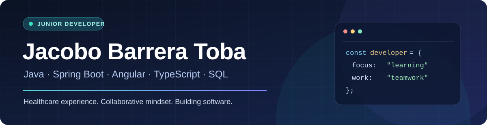

  

  <b>Junior Software Developer</b> · Barcelona, Spain 
  Java & Spring Boot · Angular & TypeScript · SQL 
  <b>Open to DAW internships and junior opportunities in 2027</b>

  <a href="https://github.com/jacobobt?tab=repositories">Repositories</a> ·
  <a href="#-selected-projects">Projects</a> ·
  <a href="#-team-contributions">Team contributions</a> ·
  <a href="#-about-me">About me</a>

---

### 👋 About me

I'm a **Junior Software Developer** completing a Higher Vocational Qualification in **Web Application Development (DAW)** at the **Universitat Oberta de Catalunya (UOC)**.

My current focus is **Java / Spring Boot**, **Angular / TypeScript**, **REST APIs**, **relational databases** and **Git-based teamwork**. I enjoy understanding existing code, building practical features and learning through collaborative projects.

I also bring **8+ years of professional experience as a Registered Nurse** in Spain and the UK, plus teaching and international clinical experience. That background has strengthened my communication, attention to detail and ability to work with multidisciplinary teams — skills I bring into software development.

### 🧰 Tech stack

  
  
  
  
  
  
  
  

Also working with: Spring MVC, Spring Data JPA, Spring Security, REST APIs, Firebase, MySQL/MariaDB, Maven and GitHub.

### 🚀 Selected projects

| Project | What it does | My involvement |
|---|---|---|
| **[Alfie Pomodoro Timer](https://github.com/jacobobt/AlfiePomodoroTimer)** · [Live demo](https://jacobobt.github.io/AlfiePomodoroTimer/) | Personal study timer with configurable focus sessions and study tracking. | **Personal project** · JavaScript, Bootstrap, browser storage; ongoing development. |
| **[ReparaYa](https://github.com/jacobobt/fp448-reparaya)** | Academic repair-management application built with PHP/Laravel and MySQL. | Team project; contributed [registration, login and user-profile features](https://github.com/jacobobt/fp448-reparaya/pull/1). |

### 🤝 Team contributions

These repositories belong to my classmates. The links below point to **specific Pull Requests that I authored and that were merged** — not to projects I claim to have built alone.

| Team project | Technologies | My verified contribution |
|---|---|---|
| **[Library management — Backend P2](https://github.com/EricKColl/FP.449-Producto2)** | Java · Spring Boot · JPA · MariaDB | [Author and user views, loan history and integration tests — PR #5](https://github.com/EricKColl/FP.449-Producto2/pull/5). |
| **[Basket roster — Frontend P2](https://github.com/EricKColl/FP.451-Producto2)** | Angular · TypeScript · Firebase | [Player deletion, confirmation flow and real-time list updates — PR #5](https://github.com/EricKColl/FP.451-Producto2/pull/5). |
| **[Library management — Backend P3](https://github.com/EricKColl/FP.449-Producto3)** | Java · Spring Security · JPA | [User registration, reservations and favourites — PR #1](https://github.com/EricKColl/FP.449-Producto3/pull/1). Project still in development. |

### 🌍 A little more about me

- **Professional background:** nursing, healthcare information systems, patient safety audits and teaching.
- **Languages:** Spanish and Galician (native) · English and Portuguese (C1) · Catalan (intermediate).
- **What I'm looking for:** a supportive development team where I can contribute, receive feedback and grow through real work — backend, frontend or full-stack, in HealthTech or any other sector.

Thanks for visiting — feel free to explore my repositories and Pull Requests.

